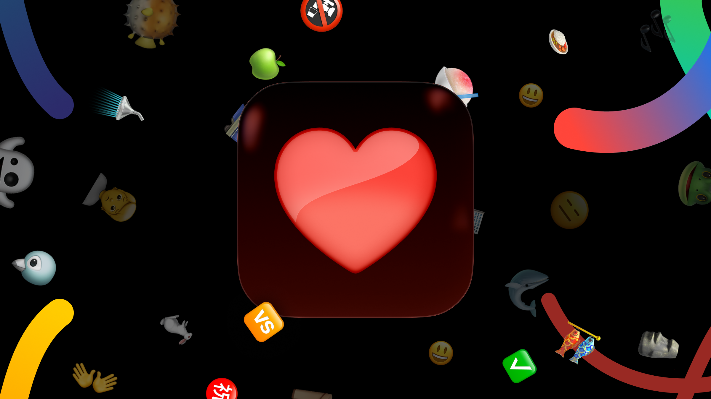

  

<h1 align="center">Haptics</h1>

Send love your friends can actually feel.

  
  

Haptics is an iOS app for lightweight tactile communication. You can send a quick vibe, drop an emoji, sketch live, or ping someone from the Home Screen widget when words feel like too much.

Read more in the launch post: [Haptics Goes Open Source](https://www.spottedinprod.com/blog/haptics-goes-open-source).

## Highlights

- Wave shocks and haptics
- Emoji Fall
- Drawing
- Home Screen widget for quick check-ins

## Under the Hood

A short tour of the implementation, summarized from the [Spotted in Prod write-up](https://www.spottedinprod.com/blog/haptics-goes-open-source).

- **Drawing** ([`DrawingView.swift`](Haptics/Sources/UIFlow/Components/DrawingView/DrawingView.swift)): each pan update redraws only the changed rect of the Bezier path. Once a live stroke gets long, its older part is snapshotted into an image, and the finished stroke goes through a Douglas-Peucker-style compaction pass before it is sent.
- **Sketch settle** ([`CompletedDrawingView.swift`](Haptics/Sources/UIFlow/Components/DrawingView/CompletedDrawingView.swift)): every sketch gets a quick scale-and-spring animation, and the receiver also sees a blur-and-opacity reveal driven by Core Animation's private filters.
- **Particle dissolve** ([`ParticleShaders.metal`](Packages/Effects/Sources/ParticleDissolveEffect/Metal/ParticleShaders.metal)): Metal compute shaders run the particle physics, render shaders draw the result, and a right-to-left wave dissolves the sketch. Several dissolves are bin-packed into shared textures.
- **Ripple** ([`WaveDistortionView.swift`](Packages/Effects/Sources/WaveDistortionView/WaveDistortionView.swift)): every tap starts a shockwave. A display link animates a radial-gradient ring and offsets a 10x10 mesh of the content with a damped sine wave.
- **Emoji fall** ([`EffectScene.swift`](Haptics/Sources/UIFlow/Components/EffectView/EffectScene.swift)): a SpriteKit emitter whose particle texture is an emoji rendered into an image, with rendered emojis cached for reuse.
- **Ayo widget button** ([`AyoWidgetButton.swift`](Widgets/Sources/UIFlow/Widgets/Ayo/Views/AyoWidgetButton.swift)): two layered shapes, one stroked and one with a linear-gradient border, plus a subtle text shadow.
- **Avatar picker** ([`EmojiInfoRequestController.swift`](Packages/SharedUI/Sources/RegistrationUI/InfoRequest/EmojiInfoRequestController.swift)): a `ContinuousClock` task swaps the emoji every 0.1 seconds, and a push `CATransition` animates each change.
- **Tooltips** ([`TooltipController.swift`](Packages/UIComponents/Sources/UIComponents/Tooltip/TooltipController.swift)): a custom transition and a `CAShapeLayer` curve that points at the highlighted element while staying on screen.
- **Toasts** ([`ToastView.swift`](Packages/UIComponents/Sources/UIComponents/ToastView/ToastView.swift)): a state machine for loading, success, and error states, debounced updates, and a custom spinner.

## Getting Started

See [RUNNING.md](RUNNING.md) for the full local setup flow, including Firebase project creation, app configuration, signing, and backend setup.

## Architecture

Haptics uses an MVVM-style architecture with dependency injection, a session pattern for shared state, centralized routing, and a modular local Swift package setup. The app is built with UIKit and backed by Firebase.

Each domain has a single source of truth. For example, [`AuthSession`](Packages/SharedSessions/Sources/AuthSession/AuthSession.swift) owns auth state and publishes it to the app and the widgets.

## Acknowledgments

- [Firebase](https://github.com/firebase/firebase-ios-sdk)
- [MCEmojiPicker](https://github.com/izyumkin/MCEmojiPicker)
- [PinLayout](https://github.com/layoutBox/PinLayout.git)
- [swift-dependencies](https://github.com/pointfreeco/swift-dependencies)

Dependency and license metadata is generated with [swift-package-list](https://github.com/FelixHerrmann/swift-package-list).

Full dependency and license inventory, including transitive packages, can be found in [Haptics/Resources/Settings.bundle](Haptics/Resources/Settings.bundle).

## License

This project is licensed under the Apache License 2.0. See [LICENSE](LICENSE) for details.
